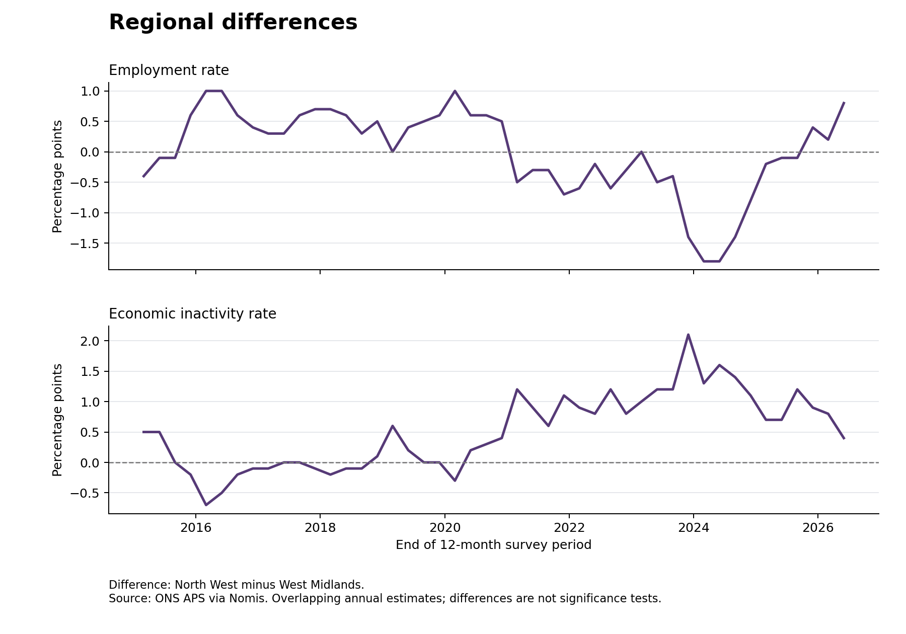
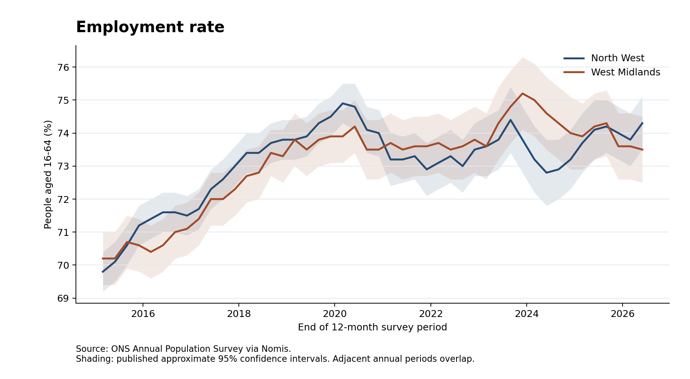
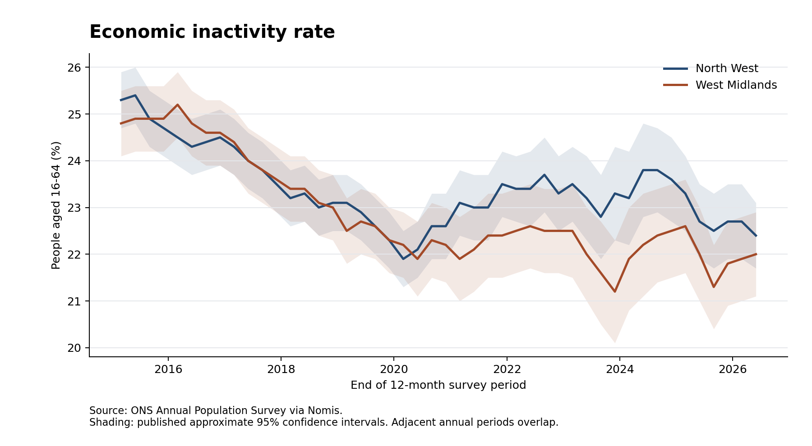

# UK Regional Labour Market Analysis

How have employment and economic inactivity differed between the North West and West Midlands? This comparison uses ONS Annual Population Survey estimates for people aged 16–64, covering annual periods ending from March 2015 to June 2026.

## Findings

For July 2025–June 2026, the latest period in the included data:

| Indicator | North West | West Midlands | Difference |
|---|---:|---:|---:|
| Employment rate | 74.3% | 73.5% | +0.8 pp |
| Economic inactivity rate | 22.4% | 22.0% | +0.4 pp |

Differences are North West minus West Midlands, in percentage points.

- Both employment rates were slightly below their calendar-2019 estimates: by 0.2 percentage points in the North West and 0.4 in the West Midlands.
- The employment ranking has changed over time. The North West's rate was 1.8 points below the West Midlands in April 2023–March 2024, compared with 0.8 points above in the latest window.
- Inactivity was 22.3% in both regions in 2019. The latest estimates were 0.1 points higher in the North West and 0.3 points lower in the West Midlands.



These are differences between survey estimates, without a test of statistical significance. The [full findings](documents/findings.md) give the baseline comparisons and historical ranges.

## Data and interpretation

Source: [ONS Annual Population Survey via Nomis](https://www.nomisweb.co.uk/datasets/apsnew), dataset `NM_17_5`. The included download, retrieved on 24 November 2026, contains 184 observations across 46 survey periods. The [data notes](data/README.md) describe the source query, fields and snapshot.

The two English regions form a descriptive case study. They are not matched controls, and the comparison does not explain the causes of their differences. Calendar 2019 provides a fixed pre-pandemic reference.

Each estimate covers 12 months; neighbouring windows overlap. Employment and inactivity share the population aged 16–64 as their denominator, but inactivity is distinct from unemployment. The level charts include the published approximate 95% confidence intervals:





ONS advises caution when interpreting APS changes because of reduced sample sizes and increased volatility; see the [survey methodology](https://www.ons.gov.uk/employmentandlabourmarket/peopleinwork/employmentandemployeetypes/methodologies/annualpopulationsurveyapsqmi). The gap chart does not supply confidence intervals for differences between regions or periods.

## Reproduce the results

Requires Python 3.12 or newer and Matplotlib. Tested with Python 3.14.4 and Matplotlib 3.10.9.

```sh
python -m pip install -r requirements.txt
python code/python/analyse.py
python -m unittest discover -s tests -v
```

The default run uses the included snapshot and makes no network requests. It checks the source hash and definitions, cleans the observations, compares periods in an in-memory SQLite database, and regenerates the tables, figures and findings. Missing or non-normal observations remain missing.

To download current estimates, or compare another pair of English regions:

```sh
python code/python/analyse.py --fetch
python code/python/analyse.py --fetch --regions 2013265921 2013265923 --start 2019-01
```

The second command compares the North East with Yorkshire and The Humber. Fresh downloads are saved separately under `data/local/`; their results go to `output/local/`. These folders are excluded from Git. A new download may contain revised estimates.

Use `--snapshot <directory>` to rerun a saved download, `--baseline YYYY-MM` to select an exact baseline period end, or `--output-dir <directory>` to choose where results are written. The script stops if source definitions change or the download is incomplete. If a baseline is unavailable, its changes remain blank.

## Outputs

| File | Contents |
|---|---|
| [observations.csv](output/tables/observations.csv) | Full cleaned series, source status flags and confidence measures |
| [period_comparisons.csv](output/tables/period_comparisons.csv) | Regional rates and gaps for every common valid period |
| [latest_comparison.csv](output/tables/latest_comparison.csv) | Latest common valid period for each indicator |
| [baseline_changes.csv](output/tables/baseline_changes.csv) | Changes in rates and gaps relative to 2019 |
| [findings.md](documents/findings.md) | Results and interpretation |

The analysis code is in [Python](code/python/analyse.py), with SQL queries for [all periods](code/sql/period_comparisons.sql) and the [latest comparison](code/sql/latest_comparison.sql).

Source: Office for National Statistics via Nomis. Contains public sector information licensed under the [Open Government Licence v3.0](https://www.nationalarchives.gov.uk/doc/open-government-licence/version/3/). See [Nomis copyright](https://www.nomisweb.co.uk/home/copyright.asp).

Code developed with AI assistance.
