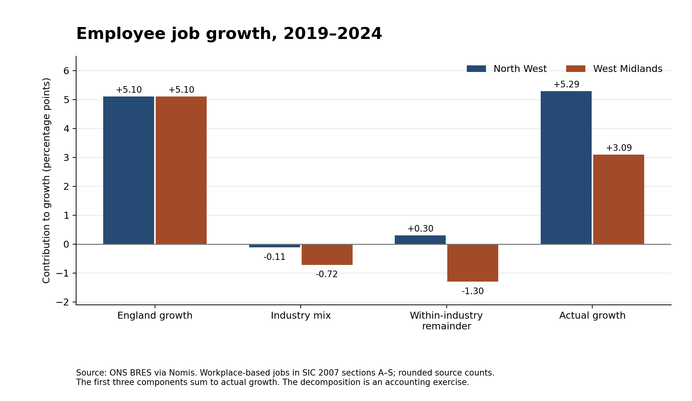
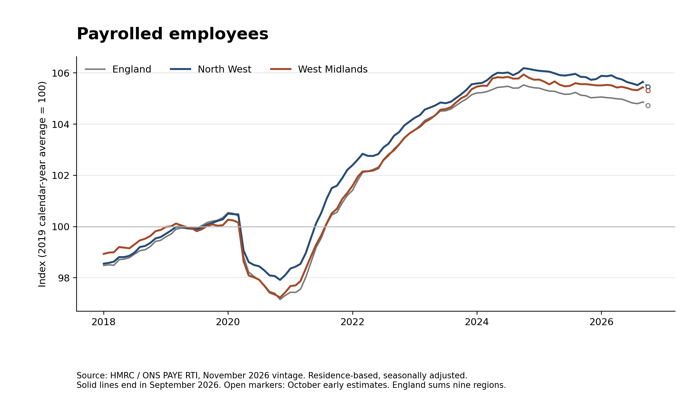
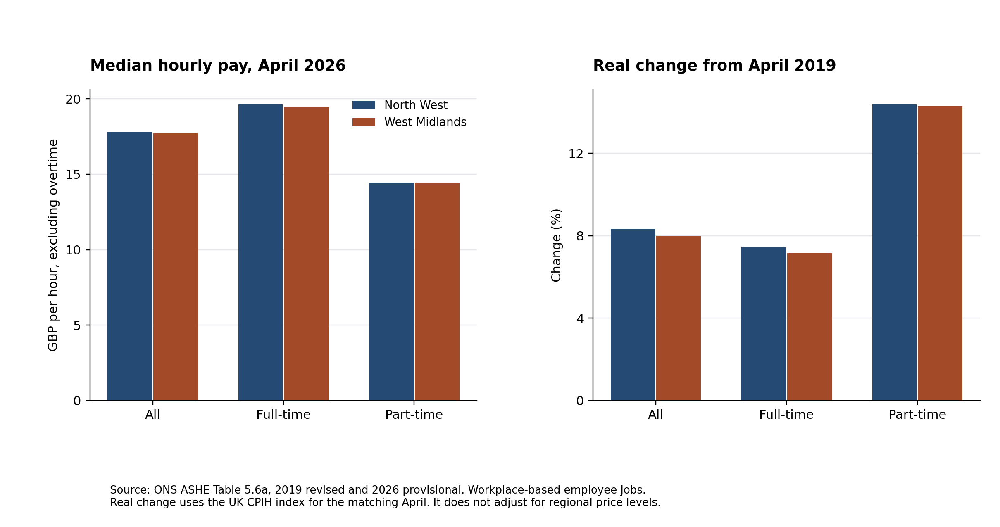

# UK Regional Labour Market Analysis

Employment, pay and industrial change in the North West and West Midlands. How have the two regions changed since 2019, and how much of their employee job growth gap is associated with their initial industry mix?

## Findings

| Measure | North West | West Midlands |
|---|---:|---:|
| Payrolled employees, September 2026: change from 2019 average | +5.65% | +5.44% |
| Workplace employee jobs, 2019–2024: growth in covered industries | +5.29% | +3.09% |
| Median hourly pay excluding overtime, April 2026 | £17.79 | £17.72 |

PAYE counts people by residence. BRES counts jobs by workplace. ASHE measures pay for eligible employee jobs, and the 2026 estimates are provisional. The different coverage and reference periods matter when comparing the results.

### Where job growth differed

The BRES employee job growth gap was **2.20 percentage points**. A shift-share decomposition assigns **0.60 points** to differences in initial industry mix and **1.59 points** to differences in growth within industry sections.



Manufacturing contributed +1.55 percentage points to the North West minus West Midlands growth gap. Transport and storage contributed −1.33 points, and wholesale and retail −1.12 points. The [industry contribution chart](output/figures/sector_contributions.png) shows all 19 sections.

The North West growth advantage remains positive when changing the baseline year, end year, benchmark and industry grouping. Its size and the allocation between components change. These are descriptive accounting results; the remainder does not identify the effect of regional policy or competitiveness.

### A smaller difference in resident payroll growth



The two PAYE paths are close. Using 2024 annual averages gives growth from 2019 of 5.93% in the North West and 5.73% in the West Midlands. The larger BRES workplace job growth gap therefore does not carry over directly to resident payroll counts.

### Hourly pay and employment rates



All-employee median hourly pay was £17.79 and £17.72 in April 2026. Compared with April 2019, the corresponding CPIH-adjusted changes were +8.34% and +8.00%. These are changes in workforce medians, rather than the pay growth of the same workers.

In the original APS comparison, the latest employment-rate gap was +0.8 percentage points and the inactivity-rate gap +0.4. Neither is significant at 5% under an approximate test using published confidence margins and zero cross-region covariance, including Holm adjustment for the two indicators. This does not establish equivalence between the regions.

[Full findings](documents/findings.md) · [Methods and assumptions](documents/methods.md) · [Data definitions and provenance](data/README.md)

## Data

| Source | Coverage in this snapshot | Role |
|---|---|---|
| [ONS APS via Nomis](https://www.nomisweb.co.uk/datasets/apsnew) | Annual windows ending March 2015–June 2026 | Resident employment and inactivity, ages 16–64 |
| [HMRC / ONS PAYE RTI](https://www.ons.gov.uk/employmentandlabourmarket/peopleinwork/earningsandworkinghours/datasets/realtimeinformationstatisticsreferencetableseasonallyadjusted) | July 2014–October 2026, seasonally adjusted | Monthly resident payrolled employee counts |
| [ONS BRES via Nomis](https://www.nomisweb.co.uk/datasets/newbres6pub) | 2018–2024, nine English regions | Workplace employee jobs and industry decomposition |
| [ONS ASHE Table 5.6a/b](https://www.ons.gov.uk/employmentandlabourmarket/peopleinwork/earningsandworkinghours/datasets/regionbyindustry2digitsicashetable5) | Revised 2019, 2024, 2025; provisional 2026 | Hourly pay excluding overtime and its quality measures |
| [ONS CPIH, L522](https://www.ons.gov.uk/economy/inflationandpriceindices/timeseries/l522/mm23) | Matching monthly price indices | Express April pay in April 2019 prices |

The included inputs were retrieved on 24 November 2026. September is the main PAYE endpoint; October early estimates are shown separately. BRES 2024 is provisional and is the latest year available in the downloaded API response. A UK price index adjusts for inflation over time, not regional living costs.

## Reproduce

Python 3.12 or newer is required. The analysis uses Matplotlib and the Python standard library.

```sh
python -m pip install -r requirements.txt
python code/python/research.py
python -m unittest discover -s tests -v
```

The default run is offline. It verifies the included data hashes and regenerates the analysis tables, PNG/SVG figures and findings. Use `--output-dir <directory>` to write a separate copy of the results.

The [prepared inputs](data/extended/) include source rows or cells and quality flags. To rebuild them from the pinned original downloads:

```sh
python -m pip install -r requirements-sources.txt
python code/python/prepare_sources.py --fetch
```

Original files are cached under `data/local/extension/`. Their hashes must match the recorded vintage. Revised downloads require a reviewed source manifest; they do not silently replace the included snapshot.

The APS-only script remains available as `python code/python/analyse.py`. Its `--fetch` and `--regions` options apply to that comparison. The expanded study uses a fixed North West–West Midlands specification.

## Tables

- [PAYE growth comparisons](output/tables/paye_summary.csv)
- [Shift-share results and sensitivity cases](output/tables/shift_share_summary.csv)
- [Contributions to the regional growth gap](output/tables/sector_gap_contributions.csv)
- [Hourly pay comparisons](output/tables/hourly_pay_comparison.csv)
- [Pay within industries](output/tables/industry_pay_comparison.csv)
- [Approximate APS tests](output/tables/aps_gap_tests.csv)

Source: Office for National Statistics and HMRC via ONS and Nomis. Contains public sector information licensed under the [Open Government Licence v3.0](https://www.nationalarchives.gov.uk/doc/open-government-licence/version/3/). See [Nomis copyright](https://www.nomisweb.co.uk/home/copyright.asp).

Code developed with AI assistance.
