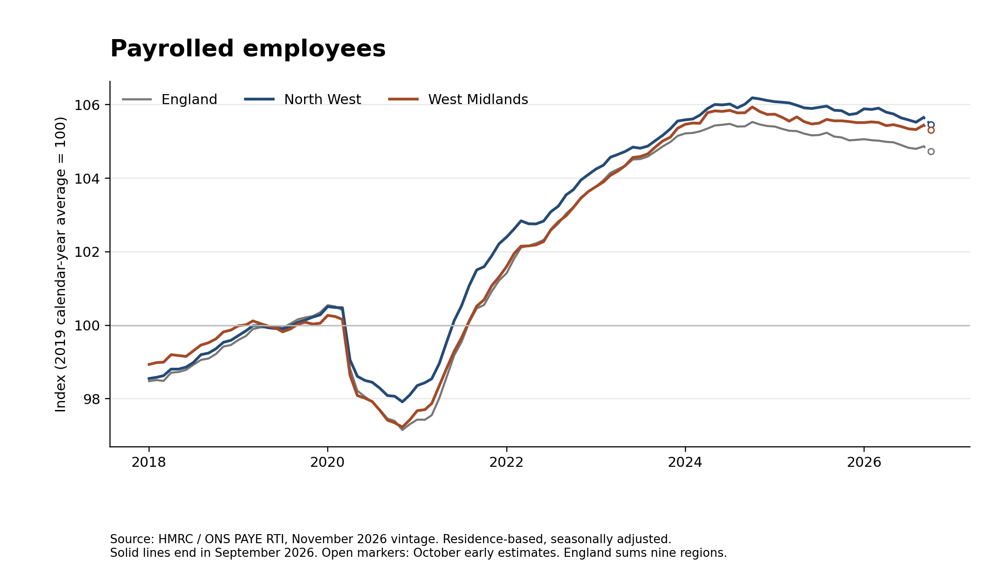

# Employment, pay and industrial change in two English regions

The comparison asks how the North West and West Midlands have changed since 2019, and how much of their employee job growth gap is associated with their initial industry mix. The sources measure different populations and locations, so each comparison is interpreted within its own scope.

## What the sources show

PAYE employment growth was close: by September 2026, payrolled employee numbers were 5.65% above their 2019 average in the North West and 5.44% above in the West Midlands. In contrast, workplace-based BRES employee jobs in the covered industries grew by 5.29% and 3.09% respectively between 2019 and 2024.

The BRES growth gap was 2.20 percentage points. The shift-share decomposition assigns 0.60 points to differences in initial industry mix and 1.59 points to differences in growth within the industry sections. The second component includes all remaining regional differences and estimation error; it is not a causal effect.

## 1. Resident employment and sampling uncertainty

The APS measures employment and inactivity rates among residents aged 16–64. For July 2025–June 2026:

| Indicator | North West (%) | West Midlands (%) | Gap (pp) | Approx. 95% interval for gap | Raw p | Holm p |
|---|---:|---:|---:|---:|---:|---:|
| Employment | 74.3 | 73.5 | +0.8 | [-0.48, 2.08] | 0.221 | 0.442 |
| Inactivity | 22.4 | 22.0 | +0.4 | [-0.74, 1.54] | 0.492 | 0.492 |

Neither comparison rejects equal regional rates at 5% under a normal approximation that sets the cross-region covariance to zero. This is not an equivalence test or a full survey-design test. The standard errors are reconstructed from rounded Nomis confidence margins. Holm adjustment covers the two latest-period indicators only. No search across historical windows is used to select significant results.

Relative to calendar 2019, employment estimates changed by −0.2 percentage points in the North West and −0.4 in the West Midlands. Those time changes remain descriptive because their covariance is not provided.

## 2. Monthly payrolled employment

| Region | Sep 2026 employees | Change from 2019 average (%) | Annual change (%) | 2019–2024 annual-average growth (%) |
|---|---:|---:|---:|---:|
| North West | 3,318,656 | +5.65 | -0.19 | +5.93 |
| West Midlands | 2,620,399 | +5.44 | -0.11 | +5.73 |

October 2026 is an early estimate. Including it changes cumulative growth to 5.46% and 5.31%. It does not change the conclusion that the two indexed PAYE paths are close. All PAYE months can still be revised.

PAYE counts people receiving pay through payroll, including paid leave and furlough. It excludes self-employment, covers all ages and assigns people by residence. An index measures changes in counts; it is not an employment rate and does not control for population growth. Monthly observations are not treated as independent samples.

## 3. Industry structure and employee job growth

| Region | Actual growth (%) | England growth (pp) | Industry mix (pp) | Within-industry remainder (pp) |
|---|---:|---:|---:|---:|
| North West | +5.29 | +5.10 | -0.11 | +0.30 |
| West Midlands | +3.09 | +5.10 | -0.72 | -1.30 |

Both regions began with an industry mix that would have grown more slowly than the English aggregate if every local industry had followed its England-wide growth rate. This compositional drag was larger in the West Midlands. The larger part of the main growth gap remains within the broad industry sections.

Manufacturing contributed +1.55 percentage points to the North West minus West Midlands growth gap. Transport and storage contributed −1.33 points, while wholesale and retail contributed −1.12 points. These opposing contributions show why a single regional average conceals substantial industry differences.

### Sensitivity to the comparison

| Specification | Growth gap (pp) | Industry-mix contribution (pp) | Within-industry remainder (pp) |
|---|---:|---:|---:|
| 2018-2024 england sections | +4.06 | +0.50 | +3.56 |
| 2019-2023 england sections | +1.22 | +0.50 | +0.72 |
| 2019-2024 england broad | +2.20 | +0.28 | +1.91 |
| 2019-2024 england sections | +2.20 | +0.60 | +1.59 |
| 2019-2024 rest of england sections | +2.20 | +0.53 | +1.67 |

The North West growth advantage remains positive in every specification shown. Its magnitude changes with the start and end years. Grouping 19 sections into four broader categories moves part of the industry-mix component into the remainder, so the allocation depends on the classification. Removing both focal regions from the benchmark leaves the main qualitative pattern intact.

BRES counts jobs at their workplace. The decomposition uses sums of SIC 2007 sections A–S, built from the published two-digit divisions. Rounded divisions need not sum exactly to the separately rounded official total. The reconciliation table preserves that difference; no count is adjusted to force agreement. No standard error for this decomposition is supplied, so the growth gap is not labelled statistically significant.

## 4. Hourly pay

| Work pattern | NW April 2026 (GBP/hour) | WM April 2026 (GBP/hour) | Gap (GBP/hour) | NW real change from 2019 (%) | WM real change from 2019 (%) |
|---|---:|---:|---:|---:|---:|
| All employees | 17.79 | 17.72 | +0.07 | +8.34 | +8.00 |
| Full-time | 19.63 | 19.46 | +0.17 | +7.47 | +7.16 |
| Part-time | 14.44 | 14.43 | +0.01 | +14.38 | +14.30 |

The latest figures are provisional. In the revised 2025 estimates, all-employee median hourly pay was GBP 17.24 in the North West and GBP 17.03 in the West Midlands, a gap of GBP 0.21. The latest aggregate pay gap is therefore smaller than in the revised 2025 comparison. These levels and changes are not significance-test results.

Pay is hourly earnings excluding overtime, measured for workplace-based employee jobs on adult rates under the ASHE eligibility rules. Full-time and part-time estimates are kept separate. Real changes deflate each April estimate using the matching UK CPIH index, expressed in April 2019 prices. A common UK deflator does not measure differences in regional living costs. Changes in medians can reflect workforce composition, rather than pay changes for the same workers.

### Pay within industries

The following table uses revised 2025 full-time estimates. Both regional median CVs must be at most 5% to be included. The full export retains all 19 sections, including suppressed or less precise estimates. The filter is a precision screen, not a significance test.

| Industry | NW (GBP/hour) | WM (GBP/hour) | Gap (GBP/hour) |
|---|---:|---:|---:|
| Manufacturing | 20.47 | 19.43 | +1.04 |
| Construction | 20.91 | 18.87 | +2.04 |
| Wholesale and retail | 15.52 | 15.84 | -0.32 |
| Transport and storage | 16.89 | 16.79 | +0.10 |
| Accommodation and food | 14.00 | 14.39 | -0.39 |
| Information and communication | 23.22 | 24.41 | -1.19 |
| Professional and technical | 21.84 | 20.31 | +1.53 |
| Administrative services | 15.95 | 16.48 | -0.53 |
| Public administration | 20.01 | 20.47 | -0.46 |
| Education | 22.32 | 21.92 | +0.40 |
| Health and social work | 18.83 | 17.29 | +1.54 |

Industry medians are not averaged to construct a regional median. The table does not hold worker characteristics constant and does not estimate a like-for-like regional wage premium.

## Reading the evidence together

The sources support a narrower conclusion than a single ranking of the two labour markets. Resident payroll counts grew at similar rates, while workplace job growth differed more and varied across industries. Latest aggregate hourly pay estimates were close. These differences in coverage and timing matter; the data cannot establish which mechanism, such as commuting, population change or worker composition, produces the patterns.

A causal explanation would require an identified shock or policy and a defensible comparison design. The shift-share remainder should not be interpreted as the effect of a regional policy, competitiveness or the pandemic.

## Sources and reproduction

- APS: July 2025–June 2026 latest window; snapshot retrieved 24 November 2026.
- PAYE RTI: November 2026 release, with October early estimates separated from September.
- BRES: available API years 2018–2024, source last updated 28 October 2025. The 2024 observations are provisional.
- ASHE Table 5.6a/b: revised 2019, 2024 and 2025; provisional 2026.
- CPIH: ONS L522, November 2026 release, matching April observations.

- [PAYE source](https://www.ons.gov.uk/employmentandlabourmarket/peopleinwork/earningsandworkinghours/datasets/realtimeinformationstatisticsreferencetableseasonallyadjusted)
- [ASHE source](https://www.ons.gov.uk/employmentandlabourmarket/peopleinwork/earningsandworkinghours/datasets/regionbyindustry2digitsicashetable5)
- [BRES source](https://www.nomisweb.co.uk/datasets/newbres6pub)
- [CPIH source](https://www.ons.gov.uk/economy/inflationandpriceindices/timeseries/l522/mm23)

Frozen prepared inputs and original-download hashes are in data/extended. The preparation script records original workbook names, sheet names and cells or rows. Run python code/python/research.py to regenerate this report, its tables and figures without downloading new data.

[APS tests](../output/tables/aps_gap_tests.csv) · [Growth decomposition](../output/tables/shift_share_summary.csv) · [Industry contributions](../output/tables/sector_gap_contributions.csv) · [Pay comparisons](../output/tables/hourly_pay_comparison.csv)
