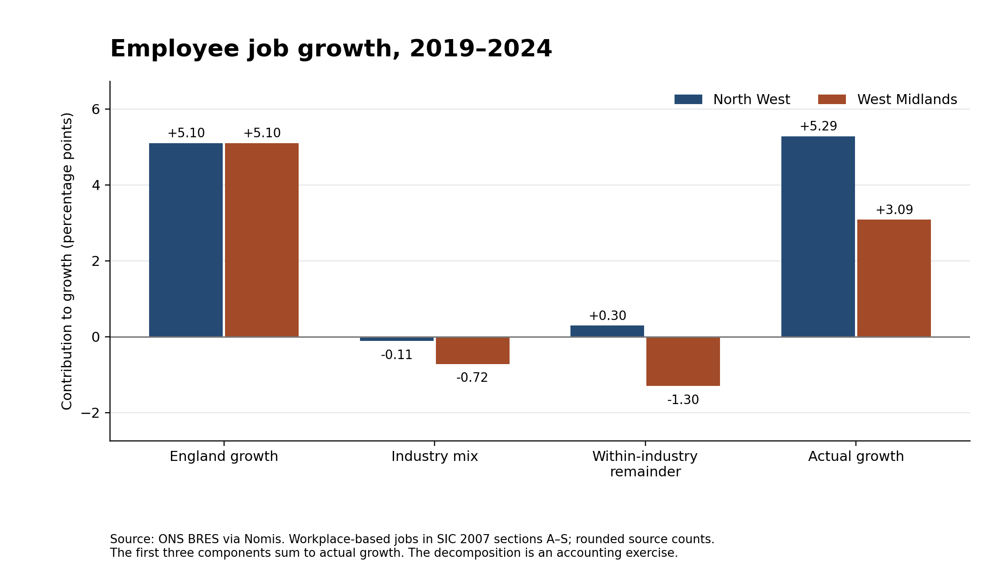
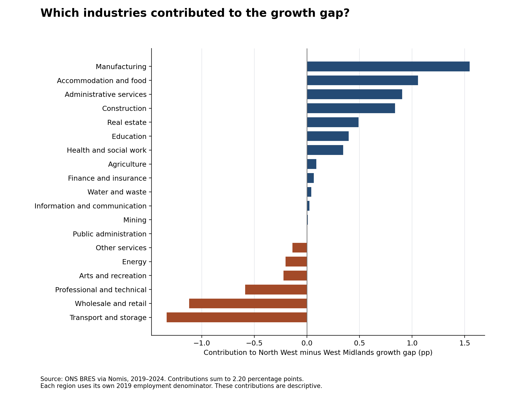
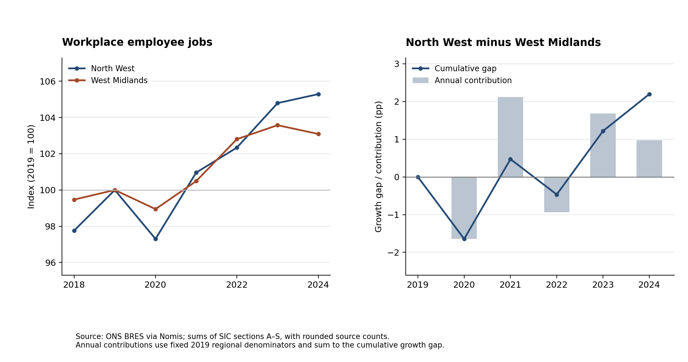
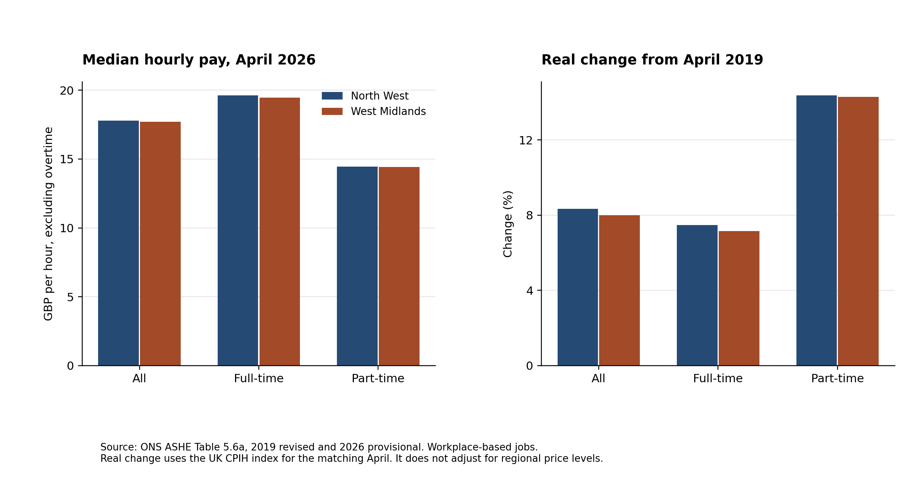

# Employment, pay and industrial change in two English regions

## Question and comparison

How much of the North West–West Midlands employee job growth gap is associated with their initial industry structure? The two regions provide a case study of employment differences within the same national statistical framework. Manufacturing accounted for 9.2% of covered employee jobs in the North West and 11.6% in the West Midlands in 2019. This difference gives industry composition a concrete role to examine. Neither region is a control group, and the comparison does not represent all regional disparities.

### Regional background

[ONS analysis of 2015 employee jobs](https://www.ons.gov.uk/employmentandlabourmarket/peopleinwork/employmentandemployeetypes/articles/thespatialdistributionofindustriesingreatbritain/2015), published in 2017, identified the West Midlands as a centre of motor-vehicle manufacturing and chemical-manufacturing concentrations in parts of the North West. These are historical features, rather than explanations of the subsequent employment changes.

The project’s own 2019 BRES baseline shows how the regions differ within manufacturing:

| Division | NW jobs | NW share of manufacturing (%) | WM jobs | WM share of manufacturing (%) |
|---|---:|---:|---:|---:|
| 10: Food products | 51,000 | 16.2 | 28,000 | 9.3 |
| 20: Chemicals | 19,000 | 6.1 | 5,000 | 1.7 |
| 25: Fabricated metals | 33,000 | 10.5 | 49,000 | 16.3 |
| 29: Motor vehicles | 19,000 | 6.1 | 53,000 | 17.6 |

These four divisions illustrate the regional profiles; they were not selected as the largest contributors to the growth gap. Shares use manufacturing employment as their denominator, rather than all regional jobs. The different mixes motivate checking the section-level decomposition against two-digit industries.

[ONS Census analysis published in 2022](https://www.ons.gov.uk/employmentandlabourmarket/peopleinwork/employmentandemployeetypes/articles/howindustrieshavechangedatalocallevelbetweencensuses/2022-12-08) also documented growth in transport and warehousing employment among Midlands residents over 2011–2021. This provides background for examining transport as a counterweight to manufacturing in the present comparison. Census resident employment and BRES workplace jobs have different populations and periods; their changes are not combined.

The case therefore compares regions with substantial manufacturing employment but different industrial profiles. It allows industry composition and within-industry changes to be examined under common national definitions. It does not establish why a particular factory, firm or worker changed employment. All results refer to the full North West and West Midlands statistical regions, rather than individual cities or combined-authority areas.

## Results

Between 2019 and 2024, covered BRES employee jobs grew by 5.29% in the North West and 3.09% in the West Midlands: a gap of +2.20 percentage points. At the section level, the industry-mix contribution is +0.60 points and the within-section remainder +1.59 points.

Using 84 active two-digit divisions changes those contributions to +0.35 and +1.85 points. The overall growth gap is unchanged; the interpretation of its components depends on industry detail.

## 1. Resident employment and sampling uncertainty

The APS measures employment and inactivity rates among residents aged 16–64. Each row uses its latest common valid annual window.

| Indicator | Window | North West (%) | West Midlands (%) | Gap (pp) | Approx. 95% interval | Raw p | Holm p |
|---|---|---:|---:|---:|---:|---:|---:|
| Employment | Jul 2025-Jun 2026 | 74.3 | 73.5 | +0.8 | [-0.48, 2.08] | 0.221 | 0.442 |
| Inactivity | Jul 2025-Jun 2026 | 22.4 | 22.0 | +0.4 | [-0.74, 1.54] | 0.492 | 0.492 |

None of the available comparisons rejects equal regional rates at 5% after Holm adjustment.

The approximation reconstructs standard errors from rounded Nomis margins and assumes zero cross-region covariance. It is not a full survey-design test. Intervals are pointwise; Holm adjustment covers the two latest-period tests. Failure to reject equality does not establish equivalence.

From Jan 2019-Dec 2019 to Jul 2025-Jun 2026, employment changed by -0.2 percentage points in the North West and -0.4 in the West Midlands. These time changes are descriptive; their covariance is unavailable.

From Jan 2019-Dec 2019 to Jul 2025-Jun 2026, inactivity changed by +0.1 percentage points in the North West and -0.3 in the West Midlands. These time changes are descriptive; their covariance is unavailable.

## 2. Monthly payrolled employment

| Region | September 2026 employees | Change from 2019 average (%) | Annual change (%) | 2019–2024 annual-average growth (%) |
|---|---:|---:|---:|---:|
| North West | 3,318,656 | +5.65 | -0.19 | +5.93 |
| West Midlands | 2,620,399 | +5.44 | -0.11 | +5.73 |

The October 2026 early estimates put cumulative growth at +5.46% and +5.31%. All PAYE months can be revised.

PAYE counts people receiving pay through payroll, including paid leave and furlough, by residence. It excludes self-employment and covers all ages. An index measures changes in counts, without controlling for population growth. Monthly observations are not treated as independent samples.

## 3. Industry structure and employee job growth

| Region | Actual growth (%) | England growth (pp) | Industry mix (pp) | Within-section remainder (pp) |
|---|---:|---:|---:|---:|---:|
| North West | +5.29 | +5.10 | -0.11 | +0.30 |
| West Midlands | +3.09 | +5.10 | -0.72 | -1.30 |

The three sections with the largest absolute contributions to the growth gap are:

| Section | NW jobs, 2019 → 2024 | NW change (%) | WM jobs, 2019 → 2024 | WM change (%) | Gap contribution (pp) |
|---|---:|---:|---:|---:|---:|
| Manufacturing | 314,000 → 310,500 | -1.11 | 301,350 → 258,600 | -14.19 | +1.55 |
| Transport and storage | 191,500 → 169,000 | -11.75 | 154,050 → 171,500 | +11.33 | -1.33 |
| Wholesale and retail | 552,000 → 502,000 | -9.06 | 414,000 → 405,000 | -2.17 | -1.12 |

Manufacturing employment fell in both regions. Its contribution to the regional growth gap therefore compares job losses, scaled by each region’s total 2019 employment. A positive gap contribution does not mean manufacturing created jobs in the North West.

The job changes and sector growth rates answer different questions from the contribution column: the latter uses all covered regional baseline jobs as its denominator. The transport and retail comparisons show why a manufacturing-only account would miss changes elsewhere in the regional economy.

[All manufacturing divisions, including endpoint changes](../output/tables/manufacturing_divisions.csv)

### When did the gap emerge?

| Year | NW growth from 2019 (%) | WM growth from 2019 (%) | Cumulative gap (pp) | Annual contribution to gap (pp) |
|---|---:|---:|---:|---:|
| 2019 | +0.00 | +0.00 | +0.00 | Baseline |
| 2020 | -2.70 | -1.05 | -1.64 | -1.64 |
| 2021 | +0.96 | +0.49 | +0.47 | +2.12 |
| 2022 | +2.34 | +2.80 | -0.47 | -0.94 |
| 2023 | +4.79 | +3.57 | +1.22 | +1.68 |
| 2024 | +5.29 | +3.09 | +2.20 | +0.98 |

The annual contributions include both widening and narrowing of the gap. From 2022 to 2024, the cumulative gap moved from -0.47 to +2.20 percentage points, a change of +2.66 points. The endpoint comparison therefore needs to be read alongside the annual path.

Each annual contribution is the difference between the two regions’ job changes divided by their respective fixed 2019 employment totals. Contributions add to the endpoint gap. They are not differences between conventional year-on-year percentage growth rates.

| Interval | Largest absolute industry contributions to the annual gap (pp) |
|---|---|
| 2019–2020 | Manufacturing +1.13; Accommodation and food +0.92 |
| 2020–2021 | Wholesale and retail -1.68; Construction +1.34 |
| 2021–2022 | Transport and storage -1.46; Real estate -1.34 |
| 2022–2023 | Health and social work +1.45; Manufacturing +1.23 |
| 2023–2024 | Health and social work -0.99; Construction +0.43 |

Before the main window, 2018–2019 job growth was +2.29% in the North West and +0.53% in the West Midlands. An earlier baseline includes that difference and uses different denominators. Ending in 2023 instead of 2024 also omits the final year’s contribution. The sensitivity results consequently describe both a stable endpoint sign and a materially changing magnitude.

Annual BRES movements can reflect survey variation, business reporting and classification changes as well as economic changes. These estimates locate changes in the published series; they cannot attribute them to the pandemic, Brexit, factory closures or particular policies.

[Annual regional series](../output/tables/bres_growth_path.csv) · [All annual industry contributions](../output/tables/bres_annual_sector_contributions.csv)

### What changes with finer industry detail?

The division-level calculation uses 84 active divisions in sections A–S. The following divisions have zero published jobs in every English region at both endpoints: 07. They are omitted from growth-rate calculations. The covered employment totals are unchanged.

Moving from 19 sections to 84 active divisions changes the industry-mix contribution to the regional gap by -0.25 percentage points, from +0.60 to +0.35. The remainder changes by +0.25 points, from +1.59 to +1.85. This isolates the accounting contribution of finer industry composition within sections; it does not identify a causal mechanism.

| Section | Original within-section gap (pp) | Finer composition (pp) | Remaining within-division gap (pp) |
|---|---:|---:|---:|
| Transport and storage | -1.32 | -0.19 | -1.13 |
| Manufacturing | +1.42 | +0.17 | +1.25 |
| Construction | +0.83 | -0.10 | +0.93 |
| Information and communication | +0.00 | -0.09 | +0.09 |
| Wholesale and retail | -1.11 | -0.08 | -1.03 |

The five sections above have the largest absolute finer-composition contributions. In each row, the last two columns sum to the original remainder. Contributions use each region's total covered baseline employment, so each column in the full section table sums to its corresponding aggregate component.

[All sections and the nested decomposition](../output/tables/within_section_composition.csv)

### Sensitivity

| Specification | Growth gap (pp) | Industry mix (pp) | Within-industry remainder (pp) |
|---|---:|---:|---:|
| 2019–2024; England; 19 sections | +2.20 | +0.60 | +1.59 |
| 2018–2024; England; 19 sections | +4.06 | +0.50 | +3.56 |
| 2019–2023; England; 19 sections | +1.22 | +0.50 | +0.72 |
| 2019–2024; Other seven English regions; 19 sections | +2.20 | +0.53 | +1.67 |
| 2019–2024; England; 4 broad groups | +2.20 | +0.28 | +1.91 |
| 2019–2024; England; 84 active divisions | +2.20 | +0.35 | +1.85 |

The North West minus West Midlands growth gap is positive in every case, ranging from +1.22 to +4.06 percentage points. Classification changes the split between composition and the remainder without changing covered job growth.

BRES counts workplace jobs. Rounded division counts need not sum exactly to the separately rounded official total; that difference is retained in the reconciliation table. The decomposition has no estimated standard errors. Its remainder includes worker and firm composition, local conditions and measurement error, among other influences.

## 4. Hourly pay

| Work pattern | NW April 2026 (GBP/hour) | WM April 2026 (GBP/hour) | Gap (GBP/hour) | NW real change from 2019 (%) | WM real change from 2019 (%) |
|---|---:|---:|---:|---:|---:|
| All employees | 17.79 | 17.72 | +0.07 | +8.34 | +8.00 |
| Full-time | 19.63 | 19.46 | +0.17 | +7.47 | +7.16 |
| Part-time | 14.44 | 14.43 | +0.01 | +14.38 | +14.30 |

The 2026 figures are provisional. In revised 2025 estimates, all-employee median hourly pay was GBP 17.24 and GBP 17.03, a gap of GBP +0.21. These are descriptive comparisons.

ASHE measures hourly earnings excluding overtime for eligible workplace employee jobs. Real changes use matching April UK CPIH, expressed in April 2019 prices. This does not adjust for regional living costs or follow the same workers over time.

### Pay within industries

Revised 2025 full-time medians are shown when both regional median CVs are at most 5%. The full export retains all 19 sections. This is a precision screen, not a significance test.

| Industry | NW (GBP/hour) | WM (GBP/hour) | Gap (GBP/hour) |
|---|---:|---:|---:|
| Manufacturing | 20.47 | 19.43 | +1.04 |
| Construction | 20.91 | 18.87 | +2.04 |
| Wholesale and retail | 15.52 | 15.84 | -0.32 |
| Transport and storage | 16.89 | 16.79 | +0.10 |
| Accommodation and food | 14.00 | 14.39 | -0.39 |
| Information and communication | 23.22 | 24.41 | -1.19 |
| Professional and technical | 21.84 | 20.31 | +1.53 |
| Administrative services | 15.95 | 16.48 | -0.53 |
| Public administration | 20.01 | 20.47 | -0.46 |
| Education | 22.32 | 21.92 | +0.40 |
| Health and social work | 18.83 | 17.29 | +1.54 |

Industry medians are not averaged into a regional median. These comparisons do not hold worker characteristics constant or estimate a regional wage premium.

## Reading the sources together

Over the common 2019–2024 comparison, the PAYE annual-average growth gap is +0.20 points, compared with +2.20 points for BRES workplace jobs. Thus the workplace and residence measures need separate interpretation even with aligned years. Commuting and multiple jobs are possible areas for further investigation, but these aggregates cannot determine their contributions. The reference-date and coverage differences also remain.

At the latest ASHE endpoint, the all-employee hourly median gap is GBP +0.07. The pay and job-growth comparisons describe different aspects of the labour market; they do not provide a single regional ranking.

## Sources and reproduction

The study uses the frozen 24 November 2026 downloads: APS annual windows through June 2026; November 2026 PAYE RTI and CPIH releases; BRES 2018–2024 (2024 provisional); and revised 2019/2024/2025 plus provisional 2026 ASHE Table 5.6a/b. Source hashes, vintages and original rows or cells are recorded in data/extended.

- [PAYE source](https://www.ons.gov.uk/employmentandlabourmarket/peopleinwork/earningsandworkinghours/datasets/realtimeinformationstatisticsreferencetableseasonallyadjusted)
- [ASHE source](https://www.ons.gov.uk/employmentandlabourmarket/peopleinwork/earningsandworkinghours/datasets/regionbyindustry2digitsicashetable5)
- [BRES source](https://www.nomisweb.co.uk/datasets/newbres6pub)
- [CPIH source](https://www.ons.gov.uk/economy/inflationandpriceindices/timeseries/l522/mm23)

Run `python code/python/research.py` to regenerate this report, its tables and figures offline.

[APS tests](../output/tables/aps_gap_tests.csv) · [Growth decomposition](../output/tables/shift_share_summary.csv) · [Industry contributions](../output/tables/sector_gap_contributions.csv) · [Pay comparisons](../output/tables/hourly_pay_comparison.csv)
